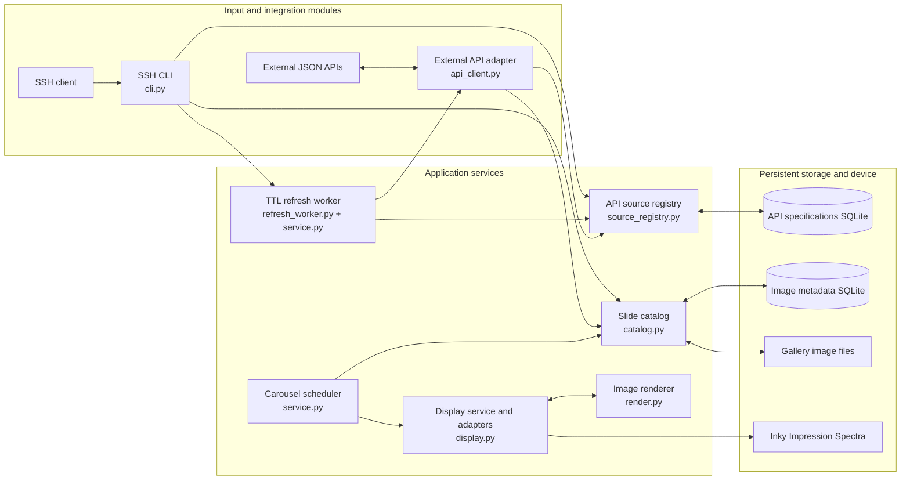

# Software architecture

See [first-time setup](first_time_setup.md) for installation,
[CLI instructions](cli_instructions.md) for commands, or the
[project overview](README.md).

The board is one Python project, organized as modules and run as one systemd
service. SSH commands are short-lived CLI invocations; the carousel scheduler
and TTL refresh worker run independently in the service process. A slide
transition never triggers an API request.

Every application component in the diagram names its implementation file,
relative to `src/epaper_display/`. External clients, APIs, storage, and the
physical panel are not application modules.

## Module responsibilities

### Input and integration modules

- **SSH CLI (`cli.py`)** handles explicit user actions: importing local images,
  selecting slides (including the interactive `pick` menu), reporting status,
  triggering refreshes, and managing API
  source specifications. It calls the registry or catalog directly and does
  not implement persistence itself.
- **External API adapter (`api_client.py`)** issues bounded HTTP requests, applies
  configured query parameters and response-field mappings, reads credentials
  from environment variables, downloads referenced images, and imports them
  into the catalog. It does not own the refresh schedule or carousel state.
- **External JSON APIs** are slide providers, not runtime dependencies of
  slide playback. An API outage leaves the already downloaded gallery
  available.

### Application services

- **API source registry (`source_registry.py`)** owns source specifications:
  endpoint URL, query parameters, enabled state, TTL, timeout, response
  mappings, and the name of an optional token environment variable. It also
  owns each source's last-success time, next-refresh deadline, failure count,
  and latest error.
- **TTL refresh worker (`refresh_worker.py` and `service.py`)** checks enabled
  sources on its own polling loop. `service.py` starts the thread and handles
  its polling; `refresh_worker.py` checks deadlines, calls the API adapter,
  and records failures. The API adapter records successful refreshes. The
  worker runs separately from slide rotation so slow network calls do not
  block display updates.
- **Slide catalog (`catalog.py`)** validates and stores local image files,
  slide metadata, expiration, and carousel selection/deadline state. It
  provides the scheduler with eligible slides without contacting APIs.
- **Carousel scheduler (`service.py`)** restores the selected slide after
  restart, advances it on the configured interval, and notices manual CLI
  selection. It delegates rendering and display output.
- **Image renderer (`render.py`)** fits gallery images to the panel's native
  resolution and applies portrait orientation and rotation.
- **Display service and adapters (`display.py`)** prepare a slide using the
  renderer, then send it through Pimoroni's Inky library on the Pi or save a
  preview PNG during development. The Inky adapter is in this same file, not
  a separate component. `run --fast` opts into the driver's experimental FAST
  refresh on supported Spectra 6 panels (Inky 2.6.0+); it does not change
  carousel timing. Normal refresh is the default.

The shared runtime configuration is in `src/epaper_display/config.py`;
`deploy/epaper-display.service` starts the application as a systemd service.

## Data ownership and persistence

Persistent application data lives under the configured data directory on the
microSD card:

- `api-specs.sqlite3` stores API source specifications and their refresh/TTL
  state. The secret token itself is never stored in SQLite; only its
  environment-variable name is.
- `catalog.sqlite3` stores slide/image metadata, per-slide enabled state,
  carousel selection, rotation pause state, and the next slide transition
  deadline. It does not store API source configuration
  or refresh state.
- `gallery/` stores the downloaded or SSH-uploaded image files referenced by
  the catalog.

SQLite WAL mode is used for both databases. The carousel selection and its
deadline are persisted. On startup, the selected eligible slide is restored,
or an expired or missing selection is replaced with the first eligible slide.
The selection receives a fresh interval, so the service does not replay
transitions missed while powered off.
While paused, timed transitions are suppressed and no transition deadline is
scheduled; manual selection and API refreshes remain available. Resuming starts
a fresh interval.
Source TTL deadlines persist separately, so a restart does not cause every
source to be fetched immediately.

## Slide and source contracts

A slide is a local image plus metadata, rather than a live API response or web
page. Each API item needs a stable identifier and an image URL; a title and
timezone-qualified ISO-8601 expiration are optional. The source ID and item ID
together identify the catalog item, so later refreshes update it rather than
creating a duplicate.

API source specifications can be managed over SSH; see
[CLI instructions](cli_instructions.md#manage-api-sources) for commands.

Field mappings support dot-separated paths in JSON objects. Query parameters
are persisted with the source. When `token_env` is configured, its value is
sent as a Bearer token to the API and to image URLs on the same origin; it is
not sent to a different image host. Put token values in the systemd environment
file, not in CLI arguments, source specifications, or JSON configuration.

The default content orientation is portrait. Images are fit to a logical
1200x1600 canvas, then rotated into the panel's native 1600x1200 pixel buffer.
Set `portrait_rotation_degrees` to `90` or `270` to match how the panel is
mounted. Preview output is rotated back to an upright portrait image.

## Runtime and language

The project is written in Python to use the Raspberry Pi and Pimoroni
ecosystem directly. Modules share a process and local storage, not separate
services. A future Rust implementation can preserve the same boundaries and
on-disk concepts; no Rust-specific assumptions are part of the slide format.
