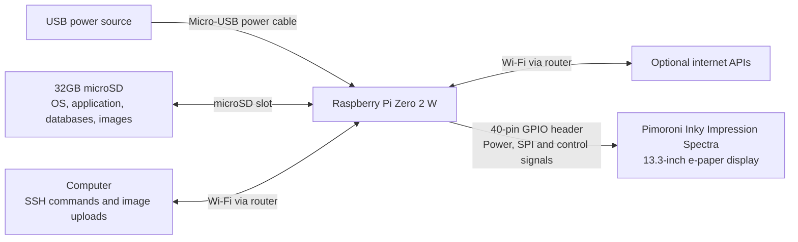

# Hardware architecture

The Raspberry Pi Zero 2 W runs the carousel and stores its images locally. The
Inky Impression display connects through the Pi's pre-soldered GPIO header;
Wi-Fi provides SSH control and optional API access.

See [first-time setup](first_time_setup.md) for installation,
[software architecture](architecture.md) for application components, or the
[project overview](README.md).

## Connection overview

The microSD card holds both the operating system and persistent gallery. The Pi
prepares each image and sends it to the display over SPI, with additional GPIO
signals controlling the refresh. Internet access is needed for API updates,
not playback of images already stored on the card.

The panel retains its last image without power, but the Pi must be powered and
running to change it. SSH also requires network access to the Pi.

## Parts list

Micro Center links are shopping references; prices and local availability may
change. A suitable USB power source is also required and is not included in the
list below.

| Component | Specification / notes | Micro Center |
| --- | --- | --- |
| Raspberry Pi | Raspberry Pi Zero 2 W with pre-soldered GPIO headers | [Product page](https://www.microcenter.com/product/683270/raspberry-pi-raspberry-pi-zero-w-2-with-headers) |
| E-paper display | Pimoroni Inky Impression Spectra, 13.3-inch | [Product page](https://www.microcenter.com/product/709266/pimoroni-inky-impression-133-eink-display) |
| Storage | 32GB microSD card | [Micro Center 32GB microSDHC card](https://www.microcenter.com/product/658457/micro-center-32gb-microsdhc-card-class-10-flash-memory-card-with-adapter) |
| Cable | Micro-USB cable; check that it supports power for the Pi | [Inland USB-A to Micro-USB cable, 3 ft.](https://www.microcenter.com/product/485276/inland-usb-20-(type-a)-to-micro-usb-(type-b)-male-cable-3-ft-black) |

## Setup notes

- The Pi Zero 2 W uses the 32GB microSD card for its operating system and files.
- The listed Pi model includes pre-soldered GPIO headers for connecting the display.
- The Pi is powered through its micro-USB power input. Confirm that the selected
  cable and USB power source meet the Pi's power requirements.
- Confirm compatibility and local stock on the product pages before purchasing.
