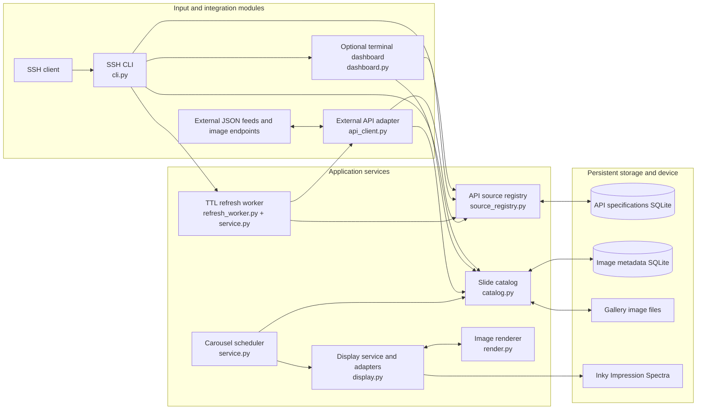

# Software architecture

See [first-time setup](first_time_setup.md) for installation,
[CLI instructions](cli_instructions.md) for commands, or the
[project overview](README.md).

The board is one Python project, organized as modules and run as one systemd
service. SSH commands are short-lived CLI invocations; the carousel scheduler
and TTL refresh worker run independently in the service process. A slide
transition never triggers an API request.

Every application component in the diagram names its implementation file,
relative to `src/epaper_display/`. External clients, APIs, storage, and the
physical panel are not application modules.

## Module responsibilities

### Input and integration modules

- **SSH CLI (`cli.py`)** handles explicit user actions: importing local images,
  selecting slides (including the interactive `display --pick` menu), reporting status,
  triggering refreshes, and managing API
  source specifications. It calls the registry or catalog directly and does
  not implement persistence itself.
- **Bulk importer (`bulk_import.py`)** accepts local ZIP files or directories,
  preflights paths and size limits, and imports supported images sequentially
  through the catalog. Optional folder preservation maps parent paths to
  carousel metadata, with the enclosing root included by default or explicitly
  ignored. ZIP extraction uses one temporary image at a time, never archive
  paths as extraction destinations. Source files remain untouched; failures
  report any already completed imports instead of implying batch atomicity.
- **External API adapter (`api_client.py`)** issues bounded HTTP requests, applies
  configured query parameters and response-field mappings, reads credentials
  from environment variables, downloads direct or JSON-referenced images, and imports them
  into the catalog. It does not own the refresh schedule or carousel state.
- **Terminal dashboard (`dashboard.py`)** is an optional Textual control process,
  launched lazily by `epd dashboard`. It polls read-only catalog snapshots,
  projects upcoming selections, and invokes the same catalog actions as the
  CLI. Browsing/search never changes playback; showing slides and applying scope
  are explicit actions. Keyboard and mouse controls do not access the display
  adapter, launch a carousel, or stop the service on exit.
- **External JSON feeds and image endpoints** are slide providers, not runtime dependencies of
  slide playback. An API outage leaves the already downloaded gallery
  available.

### Application services

- **API source registry (`source_registry.py`)** owns source specifications:
  endpoint URL, source type (`json` or `image`), query parameters, enabled state, TTL, timeout, response
  mappings, an optional default folder, and the name of an optional token
  environment variable. It also
  owns each source's last-success time, next-refresh deadline, failure count,
  and latest error.
- **TTL refresh worker (`refresh_worker.py` and `service.py`)** checks enabled
  sources on its own polling loop. `service.py` starts the thread and handles
  its polling; `refresh_worker.py` checks deadlines, calls the API adapter,
  and records failures. The API adapter records successful refreshes. The
  worker runs separately from slide rotation so slow network calls do not
  block display updates.
- **Slide catalog (`catalog.py`)** validates and stores local image files,
  slide metadata, logical folder paths, expiration, playback scope, folder
  rotation cursors, carousel selection/deadline state, and service-reported
  heartbeat/display state. It
  provides the scheduler with eligible slides without contacting APIs.
- **Carousel scheduler (`service.py`)** restores the selected slide after
  restart, advances it on the configured interval, and notices manual CLI
  selection. It delegates rendering and display output, reporting the rendering
  slide separately from the last successful display refresh.
- **Image renderer (`render.py`)** fits gallery images to the panel's native
  resolution and applies portrait orientation and rotation.
- **Display service and adapters (`display.py`)** prepare a slide using the
  renderer, then send it through Pimoroni's Inky library on the Pi or save a
  preview PNG during development. The Inky adapter is in this same file, not
  a separate component. `run --fast` opts into the driver's experimental FAST
  refresh on supported Spectra 6 panels (Inky 2.6.0+); it does not change
  carousel timing. Normal refresh is the default.

The shared runtime configuration is in `src/epaper_display/config.py`;
`deploy/epaper-display.service` starts the application as a systemd service.
Optional OpenTelemetry instrumentation in `telemetry.py` records bounded
display and source-refresh events and metrics without changing gallery storage.
See [observability](observability.md) for exporters, privacy, and setup.

## Data ownership and persistence

Persistent application data lives under the configured data directory on the
microSD card:

- `api-specs.sqlite3` stores API source specifications and their refresh/TTL
  state. The secret token itself is never stored in SQLite; only its
  environment-variable name is.
- `catalog.sqlite3` stores slide/image metadata, per-slide enabled state,
  nullable logical folder membership, playback scope, per-scope folder cursors,
  carousel selection, rotation pause state, service-reported display state, and the next slide transition
  deadline. It does not store API source configuration
  or refresh state.
- `gallery/` stores the downloaded or SSH-uploaded image files referenced by
  the catalog.

SQLite WAL mode is used for both databases. The carousel selection and its
deadline are persisted. On startup, the selected eligible slide is restored,
or an expired or missing selection is replaced with the first eligible slide.
The selection receives a fresh interval, so the service does not replay
transitions missed while powered off.
While paused, timed transitions are suppressed and no transition deadline is
scheduled; manual selection and API refreshes remain available. Resuming starts
a fresh interval.
The existing key/value `state` table also stores a heartbeat (at most once every
five idle seconds), clean shutdown state, current rendering ID, last successful
display ID/title/revision/time, output target (panel or preview), and latest
display error. These keys require no new schema migration. A failed refresh
does not replace the last successful result; an empty scope does not clear
knowledge of the image left on the panel. Reporting is not physical panel
verification. A missing heartbeat is unknown; one older than 90 seconds is
potentially offline or blocked, including a long synchronous panel refresh.
Source TTL deadlines persist separately, so a restart does not cause every
source to be fetched immediately.

`Catalog.snapshot()` reads slides, folders, state, and the upcoming projection
within one SQLite read transaction. Projection and live scheduling share the
same group chooser; projection advances only an in-memory copy of folder
cursors. It does not initialize a selection or change deadlines, scope, pause,
or persisted cursors. Future eligibility or metadata changes can alter the
projected sequence.

### Folder-aware playback

Logical folder paths are metadata; image files stay in the flat gallery under
their stable slide IDs. Paths use case-sensitive `/`-separated segments.
Parents are inferred from slide membership, including inactive slides. Existing
catalogs gain a nullable `folder` column automatically: `NULL` means a loose
root slide, not a folder or a single shared scheduling group.

For each transition, the catalog filters to enabled, unexpired slides in the
selected folder and every descendant, matching whole path segments. Each slide
directly in that scope gets its own turn, in import order; each immediate child
folder gets one turn, in path order. A folder turn cycles through all of its
eligible descendants in import order, without weighting by deeper hierarchy.
The chosen image cursor is persisted per `(scope, child folder)` in
`folder_cursors`. Manual selection also updates that folder's cursor.
Scopes without child folders use ordinary sequential slide rotation.

The scope and cursor/selection/deadline updates use the same SQLite write
transactions as carousel controls. CLI scope changes are visible to the running
service without restart and remain in effect until changed, including across
reboots. Playback lookups reject out-of-scope slides, so moving a current slide
outside the scope triggers normal selection recovery. An empty scope never
falls back to the rest of the gallery; the panel keeps its last image until an
eligible in-scope slide arrives or scope is changed. API refreshing remains
independent of playback scope.

## Slide and source contracts

A slide is a local image plus metadata, rather than a live API response or web
page. For a JSON feed, each API item needs a stable identifier and an image URL;
a title, timezone-qualified ISO-8601 expiration, and logical `folder` path are
optional. The source ID and item ID
together identify the catalog item, so later refreshes update it rather than
creating a duplicate.

Direct-image sources return image bytes instead of JSON. One slide is stored
per source, with the source ID as its title and a fixed external ID of `image`.
The URL may change without creating another entry. Direct sources share the
same query parameters, optional bearer authentication, timeout, size limits,
TTL scheduling, and failure backoff as JSON feeds. No JSON mappings are applied.
Invalid image responses leave the previous cached slide intact.

Source specifications persist their type; older databases are migrated with
`json` as the default. Source specifications also persist an optional default
folder and `folder_key` mapping (default `folder`, dot-separated paths supported).
These columns are added transactionally to existing registries without
resetting TTL state.

Folder metadata is validated before downloading its image. A supplied
per-item folder takes precedence over the source default, including explicit
`null` or an empty/root path to unfile a slide. A missing mapped field uses
the source default if configured. With neither, new API slides start unfiled
and existing folder assignments are preserved. An empty `folder_key` ignores
the feed's field. Direct-image sources use only the source default.
When present, an API assignment updates the existing folder on each successful
import, overriding any local move. The image and folder update share the
catalog transaction and file rollback path, so a failed item import leaves its
previous image and folder intact; a feed refresh is not atomic across items.

Existing slide enabled states survive refreshes; local replacements retain
folder membership. Changes
to stored image bytes increment a slide revision so the service redraws an
updated current slide without waiting for rotation.

API source specifications can be managed over SSH; see
[CLI instructions](cli_instructions.md#manage-api-sources) for commands.

Field mappings support dot-separated paths in JSON objects. Query parameters
are persisted with the source. When `token_env` is configured, its value is
sent as a Bearer token to the API and to image URLs on the same origin; it is
not sent to a different image host. Put token values in the systemd environment
file, not in CLI arguments, source specifications, or JSON configuration.

The default content orientation is portrait. Images are fit to a logical
1200x1600 canvas, then rotated into the panel's native 1600x1200 pixel buffer.
Set `portrait_rotation_degrees` to `90` or `270` to match how the panel is
mounted. Preview output is rotated back to an upright portrait image.

## Runtime and language

The project is written in Python to use the Raspberry Pi and Pimoroni
ecosystem directly. Modules share a process and local storage, not separate
services. A future Rust implementation can preserve the same boundaries and
on-disk concepts; no Rust-specific assumptions are part of the slide format.
